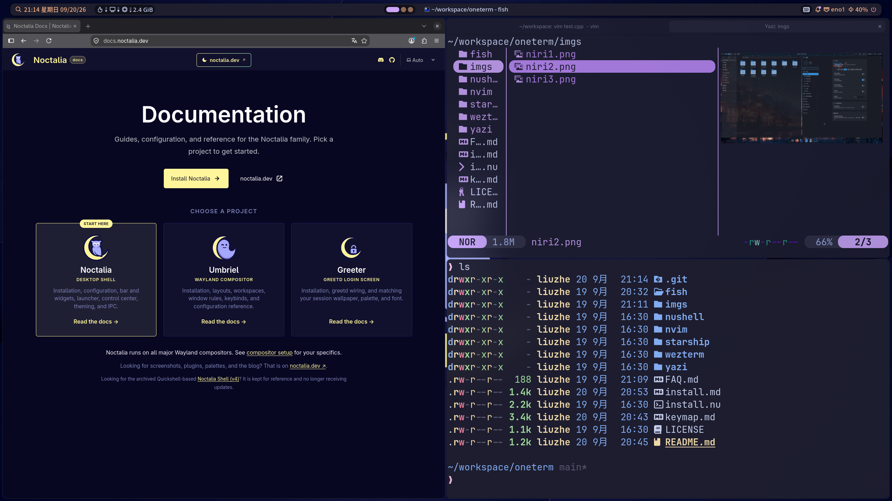
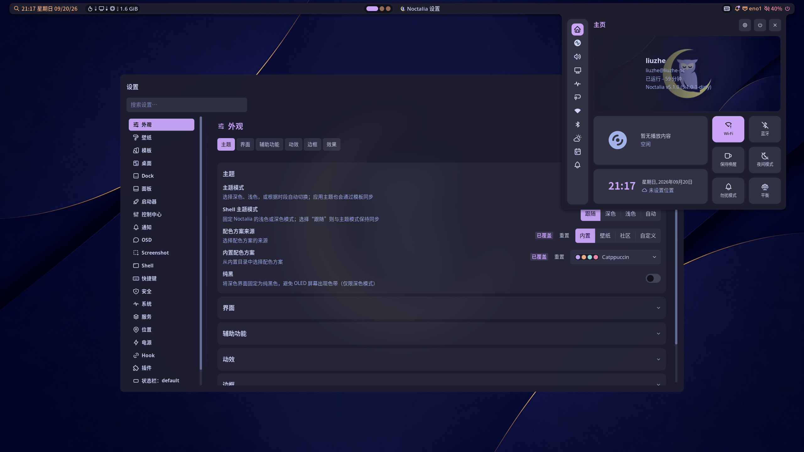
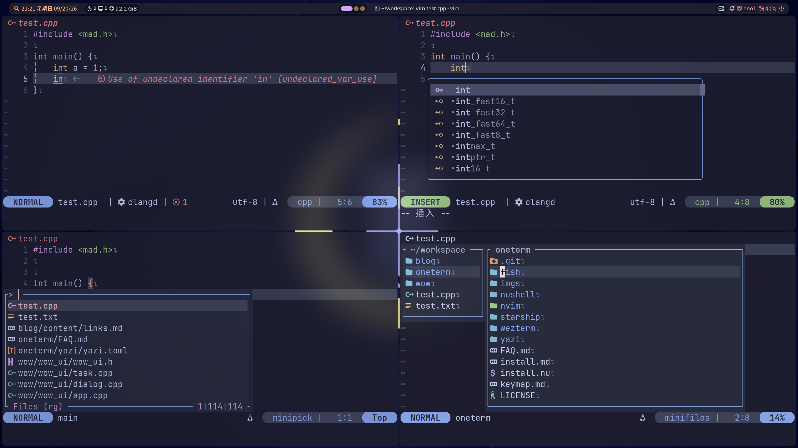
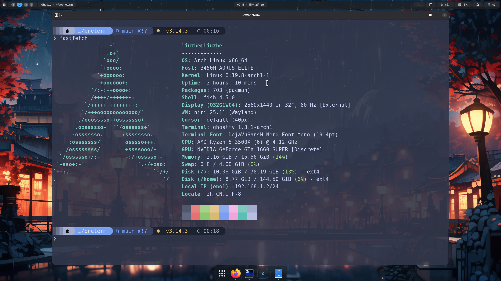
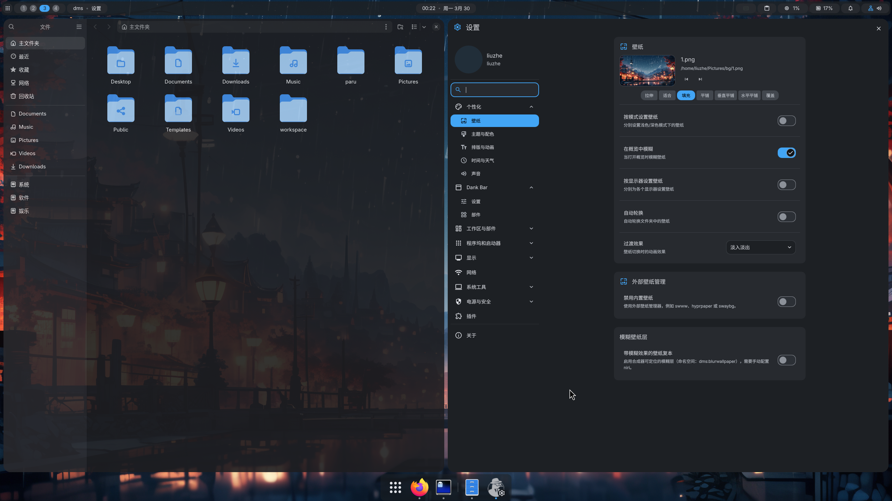
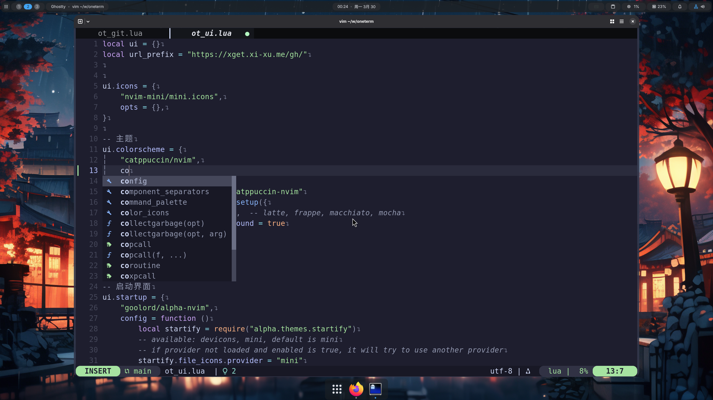

# oneterm

## 介绍

俺滴桌面与终端（丢掉鼠标🐀，拥抱⌨️）

目前使用过的工作流

- Windows: Scoop + Wezterm(或者WindowsTerminal)
    - windows将就用，基本的终端能力都在，windows上没啥毛病，感觉比WSL啥的省心
- 原生Arch: Niri + DankLinux + Wezterm
    - 完整配置太复杂，搞一套流程很麻烦，但是可以所有组件自己调整，想折腾的可以自己玩玩
    - Niri的这个无限滚动有点不适应，切换两个软件转来转去的眼晕
- CachyOS: 选Hyprland + Nocatlia + Ghostty，目前在用
    - Ghostty与Wezterm没啥大区别，看个人喜好，配置ok的话显示效果完全一样
    - GUI安装界面，一次性安装配置，只需要在安装成功后自己配置一下喜欢的主题即可
    - 个人32寸显示器，哪怕平铺4个窗口也够显示，用Hyprland感觉更合适

[安装](./install.md)

[个人Keymap](./keymap.md)

## Hyprland + Nocatlia + Ghostty

## Niri + DankLinux + Wezterm

## Windows

